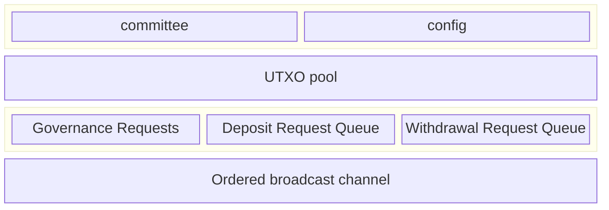

Every committee member is responsible for running a Hashi node service. Each
Hashi node exposes an HTTP service, secured by Transport Layer Security (TLS)
using a self-signed cert (each member registers its ed25519 public key in the
`CommitteeSet` on the `Hashi` object), and serves the gRPC `BridgeService` and
`MpcService`. Peers connect with their own registered TLS key, and the node
refuses any caller whose key belongs to no registered validator, except on
`/health` and `/ready`.

## How should liveness probes check the node?

The node runs 2 HTTP listeners: the TLS-secured service described above, and
a separate plain-HTTP metrics listener. The `/health` on the TLS service always
answers; liveness probes should use the `/health` on the plain-HTTP metrics
listener instead, which fails once the node's main runtime stops running tasks
for 2 minutes.

| Option | Default | Description |
| --- | --- | --- |
| `metrics-http-address` | `127.0.0.1:9180` | Address of the plain-HTTP metrics listener, whose `/health` liveness probes should use. |

## How is the Hashi Move package published?

- Hashi publishes its Move package as a normal package. It is not a system
  package and is not part of the Sui framework.

## Is the Hashi service stateless?

A main goal of this design is to make the Hashi service as stateless as
possible. Outside of any cryptographic material required for participating in
the protocol, any state critical for the functioning of the service must be
stored on Sui as part of the live object set. Correct operation of the
service must not depend on knowledge of historical transactions or events
previously emitted.

The set of data structures and state kept onchain is as follows:

## How peers authenticate over TLS

A node's TLS identity is a self-signed certificate whose key pair is the node's Ed25519 TLS signing key, so the certificate carries the same public key that the node registers onchain. The node registers that key by calling `update_tls_public_key` in the `validator` module with a proof of possession: a signature by the TLS key over a preimage built from the `Hashi` object ID, the validator address, and the public key.

When a node calls the guardian proxy, it presents its registered TLS key as its certificate. The proxy requires TLS 1.3 and a client certificate with an Ed25519 key, proven by the client's TLS 1.3 signature. Because nodes present self-signed certificates, the proxy checks no certificate chain. It reads the Ed25519 key from the certificate and decides per request which keys can call node RPCs.

## What is the ordered broadcast channel?

The ordered broadcast channel carries consensus-critical messages with total ordering: all validators see messages in the same order. A node publishes a message to the channel and receives the next message in the total order. A node can also fetch existing certificates paired with their dealer, and it must verify those certificates before acting on their weight.

## What is the UTXO pool?

The UTXO pool records the Bitcoin outputs that the bridge holds, each as active or spent. The second phase of deposit confirmation, `confirm_deposit`, mints BTC to the recipient and moves the UTXO into the active pool. A request whose UTXO is already in the pool, active or spent, aborts before any state change and before anything is minted. Withdrawal confirmation marks each input spent through its `utxo_records` entry, and `cleanup_spent_utxos` removes the record later.

## Where the onchain state lives

Hashi keeps the Bitcoin-side state in a `BitcoinState` object, attached to the `Hashi` shared object as a dynamic field keyed by `BitcoinStateKey`. Its fields are:

- `deposit_queue`: the deposit request queue, of type `DepositRequestQueue`.
- `withdrawal_queue`: the withdrawal request queue, of type `WithdrawalRequestQueue`.
- `utxo_pool`: the UTXO pool, of type `UtxoPool`.
- `user_requests`: a `Table<address, Bag>` that maps each user address to its deposit and withdrawal request IDs.

The committee and config live in the `committees` and `config` fields of the `Hashi` object. The ordered broadcast channel is the `OrderedBroadcastChannel` interface in the node, not a Move object.
