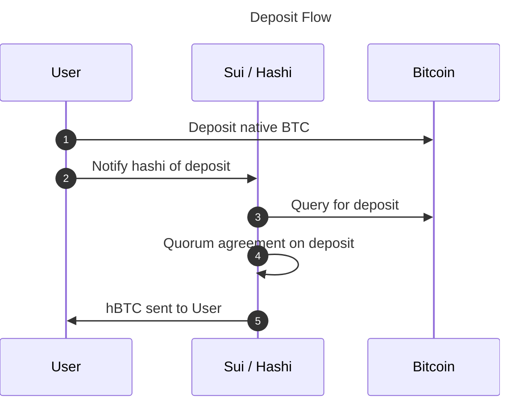
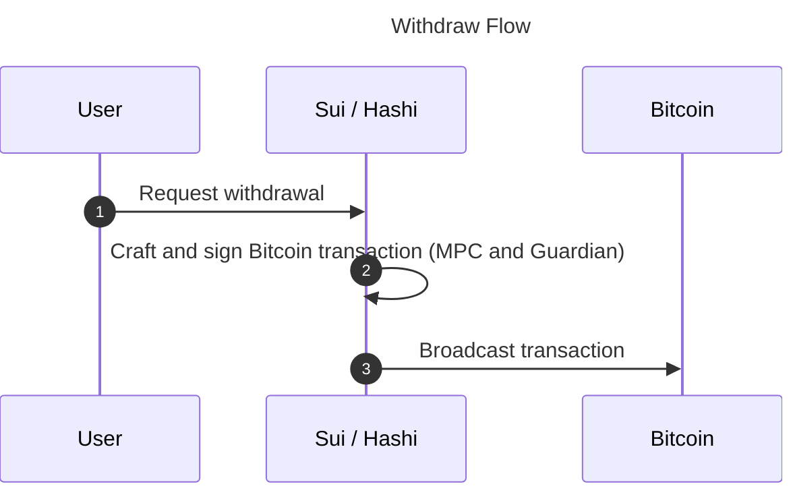

`hashi` has 2 main user flows: deposits, which
turn `BTC` into `hBTC` on Sui, and withdrawals, which turn `hBTC` back into
native `BTC` at a Bitcoin address you specify. For the phase-by-phase details,
see [Deposit](deposit.mdx) and [Withdraw](withdraw.mdx).

:::info
The only coin the Hashi protocol creates is `hBTC`, the Bitcoin-backed asset it
mints on deposit. There is no `$HASHI` token: Hashi has no governance, utility,
or airdrop token, and committee members govern the protocol by voting onchain
with their validator stake weight. Treat any `$HASHI` token offering, presale,
or airdrop as an imitation.
:::

## Deposit flow

To use `BTC` on Sui (for example, as collateral for a loan), you must
deposit your `BTC` to a Hashi Bitcoin address, spendable by the MPC committee
together with the Guardian. Your own wallet keys do not control the deposit
address. To try the flow without real `BTC`, see
[Try a deposit on Testnet](hbtc/deposit.mdx#try-a-deposit-on-testnet).

### BTC deposit address

Every Sui address has its own unique Hashi Bitcoin deposit address. See
[Bitcoin Address Scheme](address-scheme.mdx) for the full derivation
details.

### How to deposit BTC

After you determine your deposit address, you can initiate a deposit to
Hashi.

1. Broadcast a Bitcoin transaction depositing `BTC` (at least
   [`bitcoin_deposit_minimum`](config.mdx#bitcoin_deposit_minimum)) into your
   unique deposit address.
1. Notify Hashi of the deposit by submitting a transaction to Sui that
   includes the deposit transaction ID.
1. Hashi nodes query Bitcoin and watch for confirmation of the deposit
   transaction.
1. Hashi nodes communicate, waiting until a quorum has confirmed the deposit
   (after
   [`bitcoin_confirmation_threshold`](config.mdx#bitcoin_confirmation_threshold)
   block confirmations).
1. After the
   [`bitcoin_deposit_time_delay_ms`](config.mdx#bitcoin_deposit_time_delay_ms)
   window, Hashi confirms the deposit onchain, minting the equivalent amount of
   `hBTC` and transferring it to your Sui address. You can then immediately
   use the `hBTC` to interact with a DeFi protocol. For example, you can use
   the `hBTC` as collateral for a loan in `USDC`.

For step-by-step instructions with the CLI or the SDK, see
[Deposit BTC](hbtc/deposit.mdx). For a detailed breakdown of each phase, see
[Deposit](deposit.mdx).

## Withdraw flow

After you decide you want your `BTC` back on Bitcoin (for example, after you
pay off your loan), you can initiate a withdrawal.

### How to withdraw BTC

1. You send a transaction to Sui with the amount of `hBTC` you want to
   withdraw (at least
   [`bitcoin_withdrawal_minimum`](config.mdx#bitcoin_withdrawal_minimum)) and
   the P2WPKH or P2TR Bitcoin address you want to withdraw to.
1. Hashi picks up the withdrawal request and crafts a Bitcoin transaction
   that sends the requested `BTC` (minus fees) to the provided Bitcoin
   address, then signs it with the MPC committee and the Guardian.
1. The transaction is broadcast to the Bitcoin network.

For step-by-step instructions with the CLI or the SDK, see
[Withdraw BTC](hbtc/withdraw.mdx) and [Cancel a Withdrawal](hbtc/cancel.mdx).
For a detailed breakdown of each phase, see [Withdraw](withdraw.mdx).
